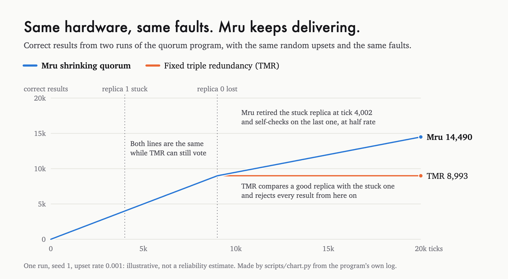

<p align="center">
  <a href="https://mru.space">
    <picture>
      <source media="(prefers-color-scheme: dark)" srcset="https://mru.space/assets/readme/mru-github-dark.gif">
      
    </picture>
  </a>
</p>

# Mru Flight

[](https://github.com/mruspace/flight/actions/workflows/ci.yml)

Onboard software for unattended missions with no repair path: it keeps a
spacecraft doing useful work as its processors fail. Part of
[Mru](https://mru.space).

Fixed triple modular redundancy (TMR) votes on three processors and stops when
it can no longer form a majority. Most spacecraft fly two strings with
autonomous fault protection instead, which makes the spacecraft safe and waits
for the ground. Stepping down from three replicas to two to one is not new: the
Space Shuttle's computers did it
([prior art](https://docs.mru.space/concepts/prior-art/)). Mru's **shrinking
quorum** does it with no ground team: vote on three, compare on two, self-check
on one.

In 10,000 simulated missions with no ground support after launch, it delivered
1.34× the useful work of fixed TMR on the same hardware. With ground support
that never ends, the gain is 1.00×
([dusk, ground support](https://github.com/mruspace/dusk#when-the-ground-can-help)).
Against autonomous baselines the result is narrower. A fallback that does not
check its last processor does more work: the shrinking quorum does 80% of it,
with 1.00% of its wrong results. Against cold standby with three strings, the
shrinking quorum does 0.92× to 1.60× the useful work, depending on how fast an
unpowered spare ages; cold standby wins on work below an aging rate of about
0.20. Under the shrinking quorum, 20.1% of simulated missions deliver at least
one wrong result, against 0.0% for fixed TMR
([dusk, two more baselines](https://github.com/mruspace/dusk#two-more-baselines)).

This repository is where that policy becomes flight software: a small,
verified Rust core, wrapped as components for NASA JPL's open-source
[F´](https://github.com/nasa/fprime) framework.

**Status (October 2026): the demo ran in orbit twice.** On 18 October 2026,
Mru Flight v0.3.1 ran on the SEPP payload processor of ESA's OPS-SAT PRETTY as
experiment exp4051: three software replicas on one processor, with faults
from a schedule, 227 seconds, every result as predicted in writing before the
run. On 22 October 2026, v0.4.0 ran there again: a hung replica, a stuck
replica, a stuck bit on the last replica caught for a safe halt with no wrong
result, and a resume after the voter was killed, again as predicted
([in orbit](#in-orbit)). That tests the software policy on a flight
processor. It is not a hardware-redundancy test and not qualification
evidence. The decision core, the demo on real processes with faults injected,
and the F´ components (three for flight, two test-only) work today, with a
first F´ deployment that runs in ESA's OPS-SAT experiment environment; the
F´ components have not run on flight hardware.

<picture>
  <source media="(prefers-color-scheme: dark)" srcset="docs/chart-dark.png">
  
</picture>

## What is here

| Crate | What it is |
|---|---|
| [`quorum`](quorum/src/lib.rs) | The decision core: vote, compare, self-check, and the health record that decides when a replica must be diagnosed. `no_std`, no allocation, no dependencies. Unit-tested, checked with [Kani](https://github.com/model-checking/kani), and built in CI for a bare-metal ARM Cortex-M target. |
| [`quorum-ffi`](quorum-ffi/src/lib.rs) | The C interface to the core ([`quorum.h`](quorum-ffi/include/quorum.h)), as a `no_std` static library. Kani proves that its decide, mode, strike and clear functions give the core's answer. Used by the F´ components, and usable from any C or C++ framework. |
| [`fprime`](fprime) | F´ v4.4.1 components: `RedundancyManager`, `HealthRegistry`, `ReplicaHost`, and the test-only `FaultInjector` and `RunRecorder`, with spares, standby and state that survives resets. 45 unit tests, and a system test against the demo on the bench schedules: wrong results match in all 60 cases, and correct results match exactly in 36 ([requirements](docs/fprime-requirements.md), [design and results](docs/fprime-design-fpp.md)). `MruOpsSat`, the first F´ deployment: the components with F´'s command, event, telemetry, health and sequencing services, driven by a Linux timer, built as a static 32-bit ARM binary for OPS-SAT PRETTY's processor ([run 3 package](docs/opssat.md)). |
| [`bench`](bench/src/main.rs) | Times the decision core on the host: nanoseconds per call of `decide()` for each policy and mode, and of `Health::strike()`. No dependencies. |
| [`demo`](demo/src/main.rs) | The `quorum` program: three replica processes, a voter built on the core, fault injection, enforced resource limits, and a report of what was delivered and what it cost. Runs on Linux and macOS; release builds are fully static binaries for 64-bit and 32-bit ARM Linux and x86_64 Linux. Its only dependency is `libc`, for the system calls behind the limits. |

### Proved, per decision

Kani checks these four properties of `decide()` for every set of three replies
(each reply absent, one value or two values, any `u64` values). CI runs all 9
proofs (4 here, 5 for the C interface) on every change. Unit tests also cover
every combination of a small value domain.

- **Same outcome as fixed TMR with two or more replicas.** Given the same
  replies, `decide()` gives the same outcome under both policies
  ([`identical_while_tmr_can_run`](quorum/src/lib.rs#L331)). It compares the
  outcome only: with two replicas, the shrinking quorum also sets `diagnose`,
  so it can retire a stuck replica where fixed TMR stays in disagreement.
- **Fixed TMR stops below two replicas**
  ([`tmr_stops_below_two`](quorum/src/lib.rs#L343)). **The shrinking quorum
  halts only when no replica is left**
  ([`shrink_halts_only_with_nothing_left`](quorum/src/lib.rs#L352)).
- **Only agreed results are delivered.** A delivered value came from at least
  two agreeing replicas, or from both runs of the last replica's self-check
  ([`delivers_only_agreed_values`](quorum/src/lib.rs#L362)).

Not covered by the proofs: `Health` (unit tests only), diagnosis and the
known-answer test (they live in the demo and the F´ components), timing, and
the system over a whole run.

### Tested, per run

**Never less than fixed TMR over a whole run** is tested, not proved. The
proof above does not carry over, because the shrinking quorum retires replicas
that fixed TMR keeps. It is checked by `scripts/scenarios.sh` over ten seeds
(kill faults only), by the bench (150 run pairs on five fault schedules, none
below fixed TMR), and in [dusk](https://github.com/mruspace/dusk) over 10,000
simulated missions, where it holds by construction.

### How the demo works

- **Three replica processes** run the same deterministic task (a hash over a
  4 KiB block derived from the tick).
- **The voter** asks the core for a verdict each tick and steps down as replicas
  fail. Self-check on one replica runs at half rate, because that replica
  computes everything twice.
- **Health scoring:** a replica outvoted three times within 200 ticks is
  diagnosed with a **known-answer test** (a fixed input whose result is known).
  Passing means the upsets were transient, so its strikes are cleared. Failing
  retires it.
- **Known-answer tests** also try to tell which side is wrong when two
  replicas disagree (see [Two replicas](#two-replicas)), and run periodically
  on the last replica to catch a stuck fault.
- **Fault injection** by schedule or at random: kill a replica, make it hang,
  make it stuck, or flip a bit in its **working memory** during a computation,
  as radiation would, so the fault travels through the real calculation. On
  one replica, a share of upsets (`--common-mode`) hits both self-check runs at
  the same place, which is how a wrong result can slip through.
- **Safe on shared hardware**: each process enforces a memory limit (128 MB by
  default) and an optional CPU-time limit on itself; the voter can cap its CPU
  share (`--cpu-percent`), stops cleanly on SIGTERM or after a maximum run time,
  and drops a replica that stops answering. See the
  [operations note for OPS-SAT](docs/opssat.md).
- **Radiation sensor** (`--sensor-mb`): a block of memory with a known pattern,
  checked at a fixed interval; every flipped bit is logged with its location
  and repaired, to measure the real upset rate on flight hardware.
- **Ready to run**: a fault schedule can come from a file (`--faults-file`), the
  summary can be written to a file for downlink (`--summary`), and
  [`opssat/run.sh`](opssat/run.sh) starts, checks and stops a long run with
  all the limits set. [`opssat/run`](opssat/run) is the foreground entry point
  for the OPS-SAT experiment runner, and [`opssat/package.sh`](opssat/package.sh)
  builds the package ([operations note](docs/opssat.md)).
- **Survives resets and power cuts**: with `--checkpoint`, the voter saves its
  state every 100 ticks (written, flushed and renamed, so a power cut leaves the
  old file or the new one), and syncs the event log first. After a reset, the
  same command resumes and ends with the same counts as a run that was never
  interrupted.
- **Every run is reproducible** from its seed.

## Run it

```sh
cargo test --workspace         # unit tests
./scripts/scenarios.sh         # scenario tests against the real program
./scripts/bench.sh             # bench: 300 runs, TMR vs shrinking quorum (below)
./scripts/kat-coverage.sh      # known-answer test coverage campaign (below)
./scripts/check-claims.sh      # README numbers against bench/results
cargo run --release --bin quorum -- --policy shrink --ticks 20000 --seed 1 \
  --upset-rate 0.001 --fault stuck:1@4000 --fault kill:0@9000
```

`--log file.csv` writes every event (stuck, hang, lost, retired, cleared,
killed, detected, wrong, stopped, sensor bit flips), and `--progress-every N`
adds the running totals every N ticks. `quorum` with an unknown option prints
all options. `python3 scripts/chart.py --png` redraws the chart above from two
such runs. To run the proofs,
install Kani (`cargo install --locked kani-verifier && cargo kani setup`) and run
`cargo kani -p quorum -p quorum-ffi`.

## Results

The same seed and faults for both policies: random upsets throughout,
replica 1 stuck from tick 4,000, replica 0 dead at tick 9,000.

```
quorum --policy tmr    ...  useful=8993  detected=11007 wrong=0 halted_at=never
quorum --policy shrink ...  useful=14490 detected=10    wrong=0 halted_at=never
```

Fixed TMR masks the stuck replica while it has three, but once another replica
dies it is left comparing a good replica with a stuck one, and every result is
rejected. The shrinking quorum retired the stuck replica two ticks after it
failed, then carried on with self-check on the last good one.

20,000 ticks, upset rate 0.001, seed 1:

| Scenario | Fixed TMR | Shrinking quorum |
|---|---|---|
| Random upsets only | 20,000 correct | 20,000 correct |
| Replicas die at 5,000 and 10,000 | 9,990 correct, **halts at 10,000** | **14,989** correct, still running |
| One dies at 5,000, one stuck at 10,000 | 9,990 correct, then **stuck in disagreement** | **14,988** correct; the known-answer test finds the stuck replica |

These are illustrative scenarios, not a reliability estimate. For statistics
over thousands of simulated missions, see [dusk](https://github.com/mruspace/dusk).

### The honest cost

On one replica, self-check cannot see a fault that gives the same wrong answer
twice. Only the periodic known-answer test (every 64 ticks by default,
`--kat-period`) can catch it, and only if the fault changes the test's answer.
Until then, wrong results get out. Fixed TMR would have stopped at the second
loss and delivered none.

`scripts/kat-coverage.sh` measures this. It kills two replicas, injects one
fault into the last one, and records whether the voter caught it, how fast, and
how many wrong results got out first. Results:
[`bench/results/2026-10-11-darwin-arm64-kat.json`](bench/results/2026-10-11-darwin-arm64-kat.json).

| Fault on the last replica, test every 64 ticks | Faults | Detected | Ticks to detect, mean (max) | Wrong before detection, mean (max) | Missed, with wrong results |
|---|---|---|---|---|---|
| Stuck result (same wrong value every time) | 256 | 100% | 31.5 (63) | 15.5 (31) | 0 |
| Hang | 64 | 100% | 0.5 (1) | 0 (0) | 0 |
| Stuck-at bit in the result | 128 | 50% | 31.5 (63) | 7.9 (17) | 64 |
| Stuck-at bit in the hash accumulator | 128 | 98% | 31.8 (63) | 15.6 (31) | 2 |
| Stuck-at bit in the working block (128 of 65,536) | 128 | 46% | 32.9 (62) | 8.2 (18) | 69 |
| Stuck-at bit in the input | 128 | 50% | 31.5 (63) | 15.2 (31) | 10 |
| Bit flip in working memory, common-mode share 0 | 400 | 100% | 0 (0) | 0 (0) | 0 |
| Bit flip, common-mode share 0.05 | 400 | 94% | 0 (0) | 0 (0) | 23 |
| Bit flip, common-mode share 0.2 | 400 | 79% | 0 (0) | 0 (0) | 84 |

What this shows:

- **One known-answer input sees about half of the stuck-at bits.** The test
  sends one fixed input. A stuck bit shows only when it changes that input's
  answer. A stuck-at-0 bit on the input is invisible by construction, because
  the test input is 0. (54 of those 64 missed input faults changed nothing in
  these short runs, only because the ticks never set those bits. In a longer
  mission they would.) A second test input would close most of this gap. It is
  planned, not built.
- **A missed stuck-at bit keeps delivering wrong results.** For a stuck bit in
  the result, about half of all later results are wrong, and nothing flags
  them.
- **Bit flips are caught by self-check, not by the test.** A flip that hits
  both self-check runs alike (the common-mode share) gives one wrong result
  that nothing flags. The test period does not change this.
- **A shorter period shortens the window for a stuck result.** At every
  period, all 256 stuck results were caught, within one period. Wrong results
  before detection averaged 1.5 at 8 ticks, 15.5 at 64 ticks and 63.5 at 256
  ticks.
- **Throughput cost.** At period 64 the test runs 0.0312 times per delivered
  result. Measured CPU cost against no test, median of 10 runs of 100,000
  ticks: 22.1% at period 8, 10.4% at period 16, and 1.9% at period 64. From
  period 32 up, the cost is smaller than the run-to-run spread (about 6% of the
  median), so treat it as "about 2%, within noise". Each test is its own
  request to the replica, which is why the cost is above one extra computation
  per period.

Scope: the demo task (a hash over a 4 KiB block) on one Apple M4, three
replica processes on one host, faults injected in software. This is not
flight hardware, not a radiation test, and not the F´ components, which do not
model stuck-at bits.

The scenario tests also caught a real flaw during development: health scoring
first retired a replica as soon as it was outvoted three times, so random upsets
could retire a healthy one, leaving the shrinking quorum with less hardware than
fixed TMR. Diagnosing with a known-answer test before retiring fixed it, and
`scripts/scenarios.sh` now checks over ten seeds that the shrinking quorum never
delivers fewer correct results than fixed TMR.

### Bench

`scripts/bench.sh` runs both policies over 10 seeds, three upset rates
(0.0001, 0.001, 0.01) and five fault schedules, 20,000 ticks per run, and
times the core with the `bench` crate. It writes one JSON and one CSV file per
host to [`bench/results`](bench/results): correct and wrong results, the tick
of the last correct result, the Graceful Degradation Index and detection
latency, with the host, processor, commit and build flags.

In all 150 pairs of runs, the shrinking quorum delivered at least as many
correct results as fixed TMR on the same faults: 1.50× with two replicas lost,
3.00× with two lost early, 1.61× with a stuck replica. Fixed TMR delivered no
wrong result. The shrinking quorum delivered some on its last replica: at most
3.6 per run on average from common-mode upsets (upset rate 0.01), and 20 when
that replica got stuck, before the known-answer test caught it 40 ticks later.
The counts are the same on
every host, and CI checks that the emulated ARM binaries match a native run.
Method, results and limits: [docs.mru.space/core/bench](https://docs.mru.space/core/bench/).

`scripts/board.sh` runs the scenario checks, the bench and a reset test on a
Linux board over SSH, with reboots or real power cuts. No run with `board.sh`
has been done yet; the procedure is in [docs/board.md](docs/board.md). The
OPS-SAT package, which runs the demo without `board.sh`, has run on the
PRETTY FlatSat and in orbit, twice ([in orbit](#in-orbit)).

### Footprint and limits

Largest resident memory of any process over all 300 bench runs per host, from
[`bench/results`](bench/results):

| Host | Largest process |
|---|---|
| Linux ARM64 (Neoverse-N2) | 1.7 MB |
| Linux x86_64 (EPYC 7763) | 2.1 MB |
| macOS (Apple M4) | 1.9 MB |

The static `quorum` binaries in the v0.2.0 release packages are 642 to 675 kB.
The 32-bit ARM (hard float) binaries of v0.3.1 and v0.4.0 are the ones that
ran on the SEPP, on the FlatSat and in orbit.

The scenario tests also check the safety limits: a hung replica is dropped
after the reply timeout, SIGTERM ends the run cleanly with no replica left, the
maximum run time is enforced, `--cpu-percent 5` keeps CPU time near 5% of wall
time, and on Linux the 128 MB memory limit is read back from the kernel for the
voter and every replica. They also check the radiation sensor, the fault
schedule file and the launcher script. In CI the whole suite also runs on the
static 64-bit and 32-bit (hard and soft float) ARM binaries under emulation.
Tagged releases package each binary with the launcher, a sample fault
schedule and the operations note.

## In orbit

On 18 October 2026, Mru Flight v0.3.1 ran on ESA's OPS-SAT PRETTY satellite
as experiment exp4051 of the OPS-SAT Space Lab, eleven days after
registration. The same package ran three times on three hosts with the same
seed and the same fault schedule (sensor self-test at tick 20, a bit flip in
replica 2 at 60, replica 1 stuck at 120, replica 0 killed at 240), each
policy capped at 110 seconds at a 5% CPU share:

| Run | Host | Shrinking quorum: correct / wrong / ticks | Fixed TMR: correct, then detected to tick | Wall (shrink, TMR) | Exit |
|---|---|---|---|---|---|
| 15 Oct 2026, ESA software environment | Linux VM, two Cortex-A53 cores in 32-bit mode | 14,886 / 0 / 29,532 | 239, then 19,250 | 110.0 s, 110.8 s | 0, 0 |
| 16 Oct 2026, TU Graz FlatSat | SEPP (Cyclone V SoC, two Cortex-A9 cores) on the bench | 2,745 / 0 / 5,250 | 239, then 4,778 | 113.2 s, 110.0 s | 0, 0 |
| 18 Oct 2026, 09:45 UTC, in orbit | SEPP on OPS-SAT PRETTY | 2,745 / 0 / 5,250 | 239, then 4,500 | 113.5 s, 113.1 s | 0, 0 |

Every event landed on the same tick on all three hosts, and the orbit run
matched the prediction written to ESA on 16 October, before the run.

On 22 October 2026, run 2 (v0.4.0) ran in orbit, 136 seconds in three
segments: the shrinking quorum on the lifecycle schedule (a bit flip at 30,
replica 2 hangs at 60, replica 1 stuck at 120, a stuck bit in the last
replica at 1,280), fixed TMR on the same schedule, and a restart, where the
voter is killed without warning and resumes from its checkpoint:

| Run 2 | Host | 1 shrink: correct / wrong | 2 fixed TMR: correct, then detected to tick | 3 restart: correct / wrong | Exit |
|---|---|---|---|---|---|
| 21 Oct 2026, TU Graz FlatSat | SEPP on the bench | 698 / 0, halted at 1,281 | 119, then 1,000 | 4,000 / 0, three resumes (an old checkpoint in the folder) | 0, 0, 137 and 0 |
| 22 Oct 2026, 09:49 UTC, in orbit | SEPP on OPS-SAT PRETTY | 698 / 0, halted at 1,281 | 119, then 750 | 1,750 / 0, one resume at tick 900 | 0, 0, 137 and 0 |

The known-answer test caught the stuck bit on the last replica on the tick
it appeared, so the quorum halted with no wrong result. After the kill, the
voter resumed with the retired replica still retired. The orbit run matched
the prediction written to ESA before it. Scope, for both runs:
three software replicas on one Linux payload processor, in user space, with
faults from a schedule, 227 and 136 seconds in orbit with no real upset in
the 64 MB sensor block. This tests the software policy on a flight processor. It is
not a hardware-redundancy test and not qualification evidence, and the 1.34×
above comes from dusk's simulated missions, not from these runs. Numbers, logs
and the operations note: [docs/opssat.md](docs/opssat.md) and
[`opssat/results`](opssat/results).

## Two replicas

With two replicas, `decide()` compares. On a mismatch, the outcome is
`Detected` under both policies, and the shrinking quorum also sets `diagnose`.
The demo then runs a known-answer test on both replicas
([`demo/src/main.rs`](demo/src/main.rs)):

- **One fails:** it is retired, and the survivor goes to self-check.
- **Both fail, or both time out:** both are retired, and the run halts, where
  fixed TMR would keep comparing. If a failure was spurious (for example a
  timeout on a slow but healthy replica), the shrinking quorum delivers less
  than fixed TMR from then on.
- **Both pass:** nothing is retired and the tick is lost. If a persistent fault
  does not change the test's answer, every later tick is also lost, the test
  runs on every tick, and nothing escalates. This is the same outcome as fixed
  TMR, which stays in disagreement.

With three replicas, a three-way split gives `Detected` with no strikes and no
diagnosis. Two replicas stuck at the same wrong value agree, so both policies
deliver it.

## Input agreement

Every replica in the demo computes from the same input, because the input is
derived from the tick. Real sensor inputs differ between replicas unless an
agreement step makes them equal first. Mru does not provide that step yet, and
neither dusk nor the bench models it.

## Limits and open questions

- **Common-mode faults.** A shared power supply, clock or thermal fault can
  hit every replica at once. Dusk models correlated deaths, and the demo models
  an upset that hits both self-check runs. Neither models a shared power supply
  or clock.
- **Replica determinism.** The demo task is a pure function of the tick.
  Interrupts and scheduling in real flight software can make healthy replicas
  disagree. This is not modeled.
- **Known-answer test coverage** is measured for the demo task on
  general-purpose processors only (above). It is not measured on target
  hardware or under radiation.
- **Command path.** Self-check on one replica can deliver a few wrong results
  before the test catches a stuck fault, and some faults it never catches.
  Use that mode for data products, not spacecraft commands, unless the mission
  adds its own command safety layer. Integrators can gate commands on
  `Verdict.mode` ([example](https://docs.mru.space/core/quorum-crate/#gate)).
- **Power.** Each extra processor costs power, and self-check doubles the work
  of the last one. Mru does no power management today.

## Qualification path

No qualification evidence exists yet, and Mru Flight makes no compliance
claim. [`docs/qualification.md`](docs/qualification.md) maps what exists (unit
tests, Kani proofs, CI, scenario tests, the bench) to NASA NPR 7150.2,
NASA-STD-8739.8, ECSS-E-ST-40C and ECSS-Q-ST-80C, and lists what has not
started.

## Releases

Tagged releases are on the
[releases page](https://github.com/mruspace/flight/releases), with static
binaries for 64-bit and 32-bit ARM Linux and x86_64 Linux, and `SHA256SUMS`.
Changes are in [CHANGELOG.md](CHANGELOG.md).

## Roadmap

1. **F´ components**: `RedundancyManager`, `HealthRegistry`, `ReplicaHost`, and
   the test-only `FaultInjector` and `RunRecorder` are built
   ([design](docs/fprime-design.md)). The first deployment, `MruOpsSat`, runs
   them with F´'s own services. A second, `MruQuorum` with three `MruReplica`
   processes, puts each replica in a process of its own on the SEPP's two
   cores, linked through F´'s GenericHub, with a real kill. Both are built for
   OPS-SAT PRETTY's processor and ran full length in ESA's experiment
   environment; a run on the SEPP is planned, not yet proposed. Next:
   `PowerAccountant` and `ScrubScheduler`.
2. **Measurements on representative processors**: static ARM Linux binaries are
   built and tested in CI under emulation. The 32-bit ARM binary ran on the
   SEPP, the flight processor of OPS-SAT PRETTY, on the FlatSat and in orbit
   (v0.3.1 and v0.4.0, October 2026). Next: real boards on the bench.
3. **Hardware-in-the-loop bench**: real boards with injected faults (bit flips,
   resets, power cuts). The scripts and the procedure are ready
   ([docs/board.md](docs/board.md)).
4. **In orbit**: done. Experiment exp4051 with ESA's
   [OPS-SAT Space Lab](https://opssat.esa.int/missions) ran the shrinking
   quorum under injected faults on the flight processor of OPS-SAT PRETTY on
   18 October 2026, with the software's own radiation sensor logged, and the
   rest of the lifecycle on 22 October 2026: a hung replica, a stuck bit on
   the last replica with a safe halt, and a resume after a kill. Both matched
   the written prediction ([operations note](docs/opssat.md)). Next: run 3,
   the F´ deployment on the SEPP, planned.
5. **On Earth**: the same software on an unattended ocean node, proposed for an
   EMSO ERIC observatory test.

## Related

- Whitepaper: W. Binns, *Mru: A Fault-Tolerant Operating System for
  Thousand-Year Autonomous Operation*, 2026.
  [doi:10.5281/zenodo.23305299](https://doi.org/10.5281/zenodo.23305299)
- Mru Field: [field](https://github.com/mruspace/field), the same core for
  hard-to-reach systems on Earth, as a supervisor that runs an operator's task
  as three replicas on one processor; version 0.1.0, tested on the bench, not
  yet on a board in a system
- Simulator: [dusk](https://github.com/mruspace/dusk), interactive at
  [dusk.mru.space](https://dusk.mru.space)
- Website: [mru.space](https://mru.space)

To cite this work, see [CITATION.cff](CITATION.cff).

## Questions or contributions

Email [contact@mru.space](mailto:contact@mru.space).

## License

Code under [Apache License 2.0](./LICENSE). The **Mru** name and mark are
trademarks; see [TRADEMARK.md](./TRADEMARK.md).
